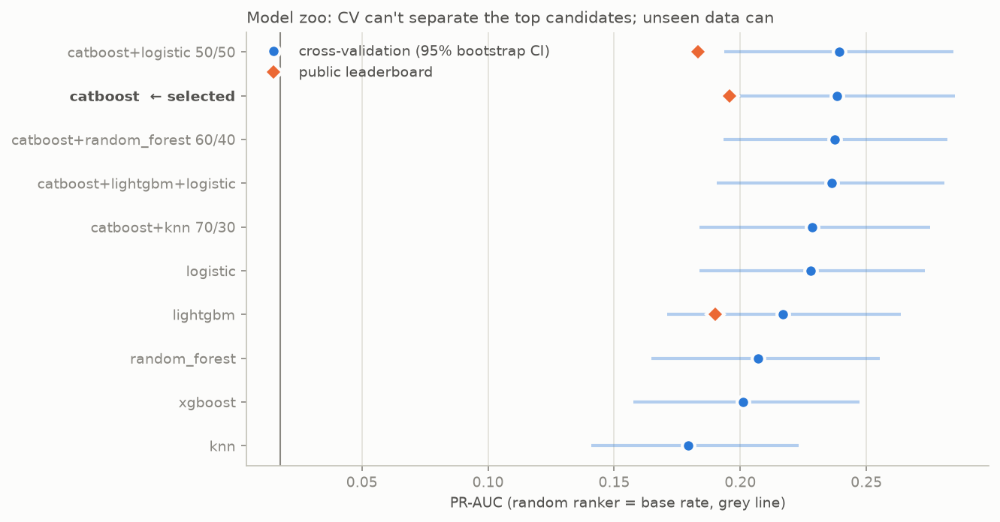
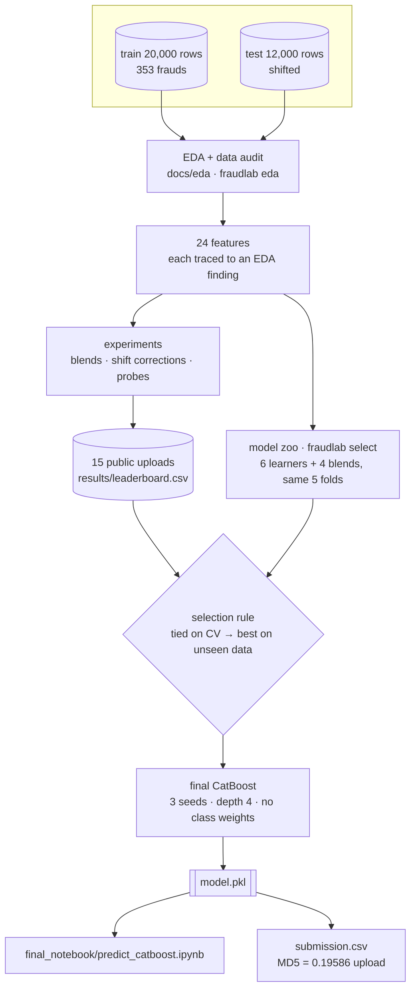
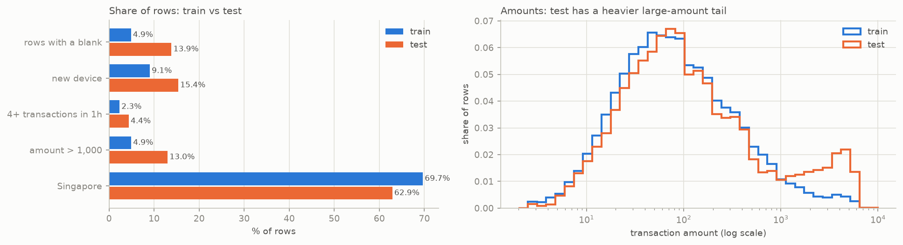
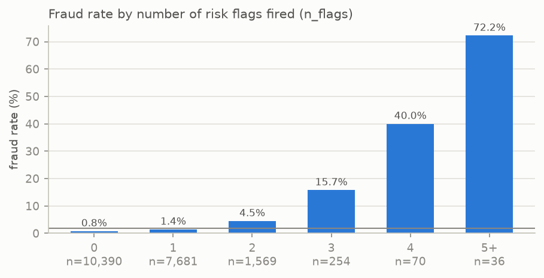
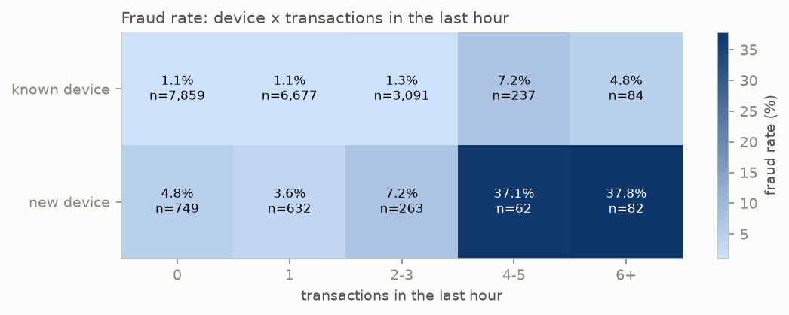
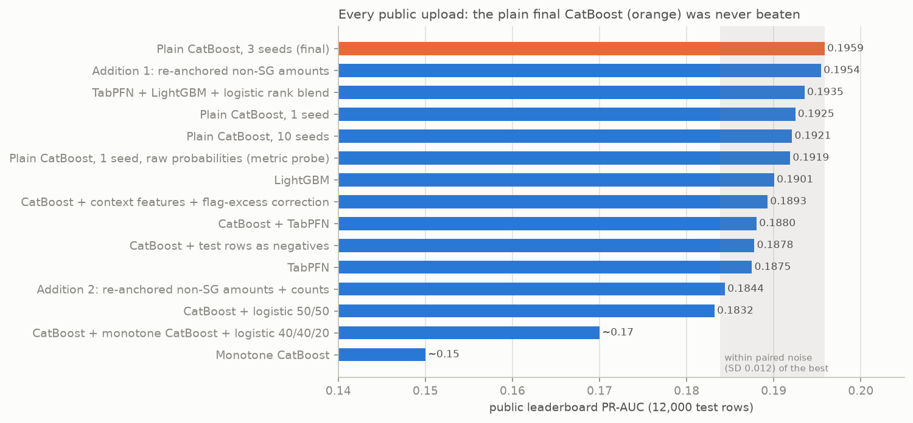
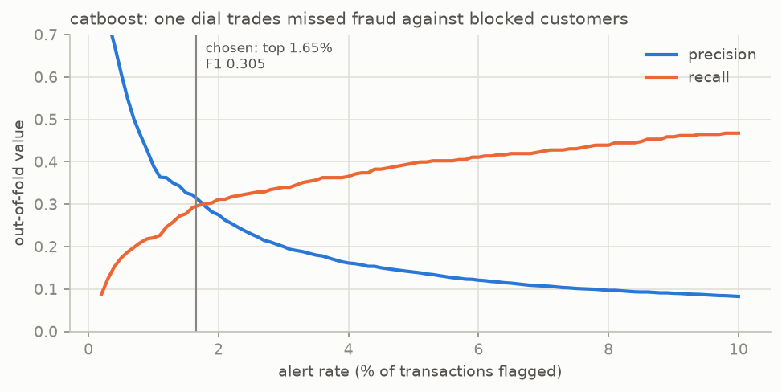

<div align="center">

# Intelligent Financial Fraud Detection

**Datathon Track 2 · ranking 1-in-57 frauds when the test set doesn't look like the training set**


-2a78d6)


</div>

One depth-4 CatBoost on 24 EDA-traced features, chosen from **10 candidates across 6 model families
(plus TabPFN and neural nets), dozens of experiments and 15 leaderboard uploads**. Every step, from raw CSV to the uploaded file, re-runs with one command and
reproduces the submission **byte for byte**.

<p align="center"></p>

## Start here

| I want to… | Go to |
|---|---|
| **Run the final submission notebook** | [`final_notebook/`](final_notebook/README.md): setup, inputs, outputs, scoring a new file |
| **Reproduce everything from raw data** | [`fraudlab/`](fraudlab/README.md): `make pipeline` runs eda → select → train → predict → verify |
| See every model family compared on identical folds | [`results/model_selection/REPORT.md`](results/model_selection/REPORT.md) |
| Read the 3 notebooks (build, compare, test the shift) and every other experiment's result | [`notebooks/`](notebooks/README.md) |
| See every public-leaderboard upload | [`results/leaderboard.csv`](results/leaderboard.csv) · [`results/`](results/README.md) |
| Read the full technical record (~860 lines, every number) | [`docs/TECHNICAL_RECORD.md`](docs/TECHNICAL_RECORD.md) · [`docs/`](docs/README.md) |
| Look up the columns and data quality | [`data/`](data/README.md) · EDA reports in [`docs/eda/`](docs/eda/) |

## Quick start

```bash
make setup        # python3 -m venv .venv && pip install -r requirements.txt
make pipeline     # eda -> select -> train -> predict -> verify   (~5 min, laptop CPU)
make final        # execute final_notebook/predict_catboost.ipynb
make test         # unit tests            (make help lists everything)
```

Without `make`: `python3 -m venv .venv && source .venv/bin/activate && pip install -r requirements.txt && python -m fraudlab all`.

## How it fits together



| Phase | What we did | What we learned |
|---|---|---|
| 1. Baseline | Regularised logistic regression, ablations of 12 ideas from published fraud papers | CV 0.233. Class weights, SMOTE, WoE and splines all hurt. A strong, explainable floor |
| 2. Blends | TabPFN + LightGBM + logistic rank blend; tuned LightGBM (70 configs) | Public 0.1935. Tiny trees with large leaves win on 353 frauds |
| 3. CatBoost | Native categoricals (ordered target statistics), native blanks | Best single model on CV (0.238) and on public (0.196) |
| 4. The shift | Monotone constraints, context features, flag-excess prior, test rows as negatives, re-anchoring, stress tests | Every correction lost on unseen data. The feature–fraud *relationship* moved, not just the features |
| 5. Final | Plain CatBoost, kept uncorrected on purpose, with a hardened cleaning layer | Public 0.19586, the best of 15 uploads; byte-identical rebuild |

<details>
<summary><b>Repository layout</b></summary>

```
├── final_notebook/          the deliverable: predict_catboost.ipynb + model.pkl (+ README, requirements)
├── fraudlab/                the pipeline package  (python -m fraudlab all)
├── notebooks/               01 build the final model · 02 compare all models · 03 test the shift
├── results/
│   ├── leaderboard.csv      every public upload and its score
│   ├── leaderboard_uploads/ the uploaded files (read-only record)
│   ├── model_selection/     model-zoo report, metrics, out-of-fold scores
│   └── <experiment>/        per-notebook outputs
├── docs/
│   ├── TECHNICAL_RECORD.md  the full technical record
│   ├── eda/                 EDA reports
│   ├── figures/             README figures (regenerated by the pipeline)
│   └── research_log/        decision log + handoffs written during the competition
├── data/                    competition CSVs + data dictionary
├── format/                  sample submission
├── tests/                   unit tests (also run in CI)
├── scripts/run_notebooks.sh execute notebooks in place, in parallel
├── Makefile                 make help
└── requirements.txt         full, pinned environment
```
</details>

---

# Technical Proposal and README

**Intelligent Financial Fraud Detection** · **Final model: CatBoost**

> **Public PR-AUC 0.196** · **Top 100 alerts: 61% fraud (OOF)** · **F1 0.305** · **Recall 0.295 @ 1.65% alert rate**
>
> Out-of-fold PR-AUC 0.238 (13× random) · one depth-4 CatBoost, 24 EDA-traced features, no class weights

---

## 1. Problem Understanding

- **Imbalance:** 353 of 20,000 transactions are fraud (1.77%) → "never fraud" scores 98.2% accuracy → accuracy is meaningless.
- **Metric:** PR-AUC (average precision) averages precision over every recall level → rewards ranking frauds at the top of an investigator's queue [1]; a random ranker scores the 0.018 base rate. F1/Recall → how many alerts a team can afford.
- **Who it serves:** an investigator with a short queue, a customer who should not be blocked, a fraudster unusual for their own account → as MAS FEAT expects [8], every decision explainable and evidence-backed.
- **Central difficulty, a train–test shift:** new devices 9% → 15%, bursts 2.3% → 4.4%, non-Singapore amounts up sharply, Singapore (70% of rows) unchanged at every quantile (a built-in control); train-vs-test classifier AUC 0.67.
- **Inference:** the most test-like training rows are richer in fraud (125 of 353 frauds in the most test-like 20%), yet every model family drops the same ∼0.045 from CV to test, and corrections in either direction hurt → the evidence suggests the feature–fraud *relationship* changed, not merely the feature distribution [2].

<p align="center"></p>


## 2. Data Processing & Feature Engineering

**Audit:** no duplicates, conflicting labels or train–test overlap; `id` carries no signal (ρ = 0.001) → dropped. Every data issue followed *finding → test → decision*:

| Finding | Test | Decision |
|---|---|---|
| Blanks rise 4.9% → 13.9% of rows in test | Not predictive of fraud (Fisher p = 0.45; all 8 columns BH q ≥ 0.43); 0/113 blank-merchant frauds too few to call "safe" | Keep blanks: Unknown / native missing branch, never zero-fill; indicators (−0.0012) and blank augmentation (−0.008) rejected |
| Amount > 24h spend in 3,904 rows | "amount > spend" flag: no signal (1.82% vs 1.74%) | Use spend as given; don't over-interpret |
| Heavy right tail; frauds live in it | P99 clipping lowered PR-AUC | Keep outliers |
| Fraud 0.8% → 16% → 72% at 0/3/5+ of the model's 6 risk flags | night × new_device significant in 10/10 folds | Flag count `n_flags` + an interaction-learning model |

<p align="center"></p>

<p align="center"></p>


- **Features:** 24, each traced to an EDA finding → `n_flags` joint 2nd most important (8.7%). Account-relative: amount vs the account's own average 24h ticket (5.8%), and the 1h share of the day's activity.
- **No leakage:** these use only the same row's provided 1h/24h fields, never the label or statistics across rows or folds; category statistics use CatBoost's ordered scheme [3].

## 3. Model Selection & Justification

| | **CatBoost (final)** | CatBoost + logistic blend | LightGBM (tuned) | CatBoost + monotone |
|---|---|---|---|---|
| CV PR-AUC | **0.238** | 0.238 | 0.217 | tied (+0.006) |
| Public PR-AUC | **0.196** | 0.183 | 0.190 | ≈0.15 |

*Cross-validation cannot separate these models; unseen data can.*

<p align="center"></p>


- **Compared:** L2 logistic baseline (CV 0.233), XGBoost, LightGBM, random forest, TabPFN, MLPs, blends → logistic and blends were competitive on CV → CatBoost was *not* chosen for its CV score.
- **Why CatBoost:** learns combinations of signals; logistic adds a fixed bonus per flag that misfired on the shifted test (its test top 2% was 72% bursts vs 21% among training frauds) → plus leakage-free category encoding [3] and native blank handling. Simpler beat complex: every more complex alternative lost on unseen data.
- **Shift corrections tried:** covariate reweighting, context-relative features, monotone constraints, flag-excess prior, test rows as negatives, reanchoring, stress tests → several helped in CV → all lost on public → deliberately kept uncorrected: each correction bets on one shift, and the private set may shift differently. **Safeguards instead:** a threshold set as a share of each scored file; a cleaning layer turning impossible values, unseen categories and missing columns into blanks, not crashes.
- **Tuning:** random searches (70 LightGBM, 20 CatBoost configs) + 8 variants, settings tuned on CV only (kept if paired per-fold gain > 2 SE) → depth 4, lr 0.03 × 800, L2 10, 3 seeds; depth 3, one-hot, Depthwise lost (−0.006 to −0.018) → tiny, regularised trees win on 353 frauds. CV mis-ranked whole designs → public test used only as an external robustness signal: a few pre-stated hypotheses, one per upload, never a parameter search.
- **No class weights:** weights and SMOTE cost 0.016–0.04 PR-AUC in every family, broke calibration (Brier 0.015 → 0.09) [4] → recall set at the threshold instead [5].
- **Explainability (FEAT Transparency & Accountability):** named EDA-traced features; ablations price each signal (device −0.038 PR-AUC); shallow trees limit interaction depth; byte-identical reruns → every alert re-derivable in an audit.
- **Assumptions:**
  1. rows are independent (repeat-account collisions only at chance level);
  2. labels are correct;
  3. the feature–fraud link carries over to new data (strained by the shift);
  4. blanks carry no fraud signal (blank rows are fraud at about the normal rate, p = 0.45; only blank merchant/device rows held none; test has 3× more);
  5. organisers threshold at 0.5 (unconfirmed).

## 4. Evaluation Strategy

- **Validation:** stratified 5-fold CV, all preprocessing fitted inside training folds → out-of-fold PR-AUC 0.238 [95% CI 0.194, 0.292]; public 0.196. 1/3/10 seeds scored 0.1925/0.1959/0.1921 on public → read 0.196 as ∼0.193; gaps < 0.01 are noise [6].
- **Operating point:** PR-AUC depends only on ranking → used for model selection. For F1/Recall: out-of-fold-optimal alert share = top 1.65% (recall 0.295, precision 0.315, F1 0.305) → order-preserving map puts exactly those rows at ≥ 0.5 → ranking, hence PR-AUC, unchanged.
- **What 0.5 means:** an operating threshold ("in the alert queue"), not a 50% fraud probability. Native probabilities exist before the map (no post-hoc calibration; well calibrated by decile, Brier 0.0150 vs 0.0173 base rate); unmapped, they rarely reach 0.5 → recall near zero.
- **Missed fraud vs. blocked customers, one transparent dial:**

  | Alert rate | 1% | 1.65% | 5% |
  |---|---|---|---|
  | Recall | 0.22 | 0.30 | 0.40 |
  | Precision | 0.39 | 0.32 | 0.14 |

  A bank fearing missed fraud more can turn the dial without retraining.

<p align="center"></p>


## 5. Limitations & Risks

- **Shift:** the apparent feature–fraud change remains unresolved. **Silent fraud:** 23% of frauds fire none of the 6 risk flags; recall only 47% at a 10% alert rate. **Few positives:** 353 frauds; learning curve still rising.
- **Fairness (FEAT):** non-Singapore rows fill 89% of the test top 2%, but country carries only 3.8% of importance and removing their extra bursts lowered public PR-AUC (0.184) → suggesting behavioural signals rather than country alone; monitor country alert rates.
- **Next:** account ids and timestamps, investigator feedback [7], per-alert SHAP explanations, cost labels.

---

## References

1. Dal Pozzolo et al., *Expert Syst. Appl.*, 2014.
2. Moreno-Torres et al., *Pattern Recognition*, 2012.
3. Prokhorenkova et al., *NeurIPS*, 2018.
4. van den Goorbergh et al., *JAMIA*, 2022.
5. Elkan, *IJCAI*, 2001.
6. Cawley & Talbot, *JMLR*, 2010.
7. Dal Pozzolo et al., *IEEE TNNLS*, 2018.
8. MAS, *FEAT Principles*, 2018.

---

## Reproducibility

| Check | How |
|---|---|
| Rebuild the model from raw data and compare | `python -m fraudlab train && python -m fraudlab verify`: retrained test scores equal the shipped model's exactly |
| Submission identical to the 0.19586 upload | `python -m fraudlab predict && python -m fraudlab verify`: MD5 `d666afc9c1454c2933b2aca8e21933fb` |
| Every notebook re-runs | `make notebooks` (outputs saved in the notebooks) |
| Environment | `requirements.txt`, pinned; CatBoost 1.2.10 with `thread_count=3`, because its fitted trees depend on the thread count |
