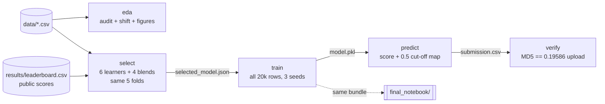

# `fraudlab`: the pipeline

A small package that turns the project's notebooks into one reproducible command line. Every stage reads `data/`
and writes `results/` or `docs/figures/`. The final notebook does not depend on it. It does depend on the
`model.pkl` that `train` rebuilds.

```bash
python -m fraudlab all        # eda -> select -> train -> predict -> verify   (~5 min on a laptop CPU)
make pipeline                 # same thing
```



## Stages

| Stage | What it does | Outputs |
|---|---|---|
| `eda` | Data-quality audit, train-vs-test shift table, the README figures | `results/eda/*.csv`, `docs/figures/*.png` |
| `select` | Cross-validates every model family on identical folds, adds rank-average blends, bootstraps PR-AUC CIs and paired differences, applies the selection rule | `results/model_selection/` (`REPORT.md`, `leaderboard.csv`, `oof_scores.csv`, `selected_model.json`) |
| `train` | Fits the selected candidate on all 20,000 rows (CatBoost: 3 seeds, 3 threads). For CatBoost it writes the exact bundle the final notebook loads | `results/final/model.pkl` |
| `predict` | Scores the test file and maps scores monotonically so the CV-optimal alert share sits at ≥ 0.5 | `results/final/submission.csv` |
| `verify` | Shipped bundle constants = config. Shipped model → MD5 of the 0.19586 upload. Retrained model's test scores = shipped model's. Pipeline submission MD5 = upload | pass / fail per check |

`predict` also scores other files: `python -m fraudlab predict --test new.csv --out preds.csv`.
`select` can drop slow learners: `python -m fraudlab select --skip random_forest`.

## The selection rule

Fixed before looking at the results (docstring of [`select.py`](select.py)):

1. Rank candidates by out-of-fold PR-AUC.
2. Shortlist every candidate **statistically tied** with the CV leader: the paired bootstrap 95% interval of
   (candidate − leader) contains 0.
3. Among the shortlist, prefer evidence from **unseen data**: the highest public-leaderboard score. The public set
   is used only as this tie-breaker, never for tuning.
4. If nothing on the shortlist was uploaded: the simplest candidate, then the best CV.

This encodes the project's main methodological lesson. CV could not separate the top designs (CatBoost alone
vs CatBoost blends), but the shifted test set could.

## Modules

| Module | Contents |
|---|---|
| [`config.py`](config.py) | paths, schema, the 24-feature order, frozen final-model settings, the expected MD5 |
| [`data.py`](data.py) | loading; `sanitise` (defensive cleaning for unseen data) |
| [`features.py`](features.py) | `engineer` (24 features + 2 smooth velocity columns for linear models), `make_features` |
| [`models.py`](models.py) | the model zoo: logistic, random forest, LightGBM, XGBoost, in-context kNN, CatBoost; `CANDIDATES` (singles + blends) |
| [`evaluate.py`](evaluate.py) | folds, F1-optimal alert share, metrics, paired bootstrap, the order-preserving score map |
| [`select.py`](select.py), [`train.py`](train.py), [`eda.py`](eda.py) | the stages |
| [`plots.py`](plots.py) | shared chart style (the colour pair validated for colour-vision deficiency) |

Unit tests: `make test` ([`tests/test_pipeline.py`](../tests/test_pipeline.py)) covers the schema, the feature order,
`sanitise` edge cases (text, negatives, hour 25, unseen categories, missing columns) and the score map's
order preservation.
